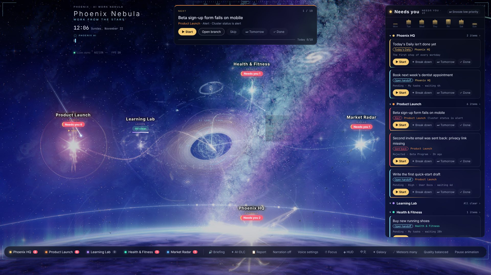

# Phoenix Nebula

**Your projects as a living 3D nebula.** Phoenix Nebula is a single-page dashboard you can run as a browser tab or a desktop wallpaper. Each project is a constellation. Tasks, handoffs from your AI assistants and things that need you drift in as signals. Open it, and the most important next step is already at the top.



> **Status: early, and looking for feedback.** It started as a personal dashboard and is now open source to find out whether it is useful to anyone else. Tell us what works, what doesn't and what you'd want: [open an issue](../../issues/new/choose) or start a [discussion](../../discussions). Feedback in any language is welcome.

## What it does

- **Next step first.** A "Next" card always shows the most urgent thing that needs you, with Start / Skip / Tomorrow / Done.
- **Projects as constellations.** Each project has a shape picked from its name (or traced from an image you upload), a color, a status and its modules. Click one to see what it is doing and what it needs from you.
- **Needs you.** Alerts, rejected work, open handoffs, silent modules and your own tasks, ranked and grouped by project.
- **One click to Claude.** ▶ Start opens Claude (or a Claude Project you bind to the branch) with a ready-made prompt for that task.
- **AI-DLC panel** (optional, needs AI): an idea inbox that files loose thoughts, a task breakdown into steps with acceptance criteria, and a skill library for prompts you repeat.
- **Daily rhythm.** Today's plan, a progress bar, a daily report you can copy, a weekly review, and a 25-minute focus timer.
- **Voice briefing.** An original voice cast reads your day in English, Japanese or Chinese, with subtitles (uses your system's voices).
- **Looks good on a wallpaper.** Bloom, TAA, aurora, comets, an asteroid belt, a space station whose windows light up as you finish tasks, plus a night mode. Eye comfort first: no camera fly-throughs or full-screen flashes.
- **Bilingual UI.** English by default; Traditional Chinese with one click (the 中文 / EN button).

## Quick start

1. Download or clone this repository.
2. Open `index.html` in Chrome, Edge or Firefox.

That's it. You'll see demo data. Everything you change is saved in your browser (localStorage), and nothing is sent anywhere.

To serve it instead (GitHub Pages, a local server):

```bash
python3 -m http.server 8000
```

Then open http://localhost:8000.

**As a desktop wallpaper:** point a wallpaper app that can show web pages (for example Lively Wallpaper on Windows) at `index.html`. Add `#wallpaper` to the URL to keep clear of the taskbar and desktop icons.

## Use your own data

You have three options, from simplest to most automatic:

| Option | How |
|---|---|
| **By hand** | Open **✦ Galaxy** to add, rename, recolor or reshape constellations. Add tasks in each constellation's card. |
| **From an AI assistant** | **＋ Import** accepts JSON status reports. Copy the report format from the import panel and give it to Claude or another assistant. |
| **From Notion** | Run `tools/notion-sync.mjs` on a schedule. It reads one Notion database (read-only) and writes `phx-data.js` next to `index.html`; the page picks it up by itself. See [docs/notion.md](docs/notion.md). |

**HUD → Local data** has backup, restore, "demo data" and "start empty".

## AI features (optional)

The AI plan, the AI-DLC panel and AI-written voice scripts need Claude. You have two options:

- **Run it as a claude.ai Artifact.** The page then uses Claude, a shared database and Claude voices with no key. See [docs/architecture.md](docs/architecture.md).
- **Use your own Anthropic API key.** Add it under **HUD → AI (your API key)**. The key is stored only in your browser and sent straight to `api.anthropic.com`. Only do this on your own computer; anyone with access to that browser profile can read it.

Everything else works without AI.

## Settings

Copy `phx-config.example.js` to `phx-config.js` to set the default language, the daily check-in cluster and links. `phx-config.js`, `phx-data.js` and your Notion config are git-ignored.

Keyboard shortcuts: `/` search · `N` next · `S` start · `D` done · `Z` tomorrow · `1–9` constellations · `B` briefing · `F` focus · `I` idea · `P` plan · `R` report · `Esc` close.

## Project layout

```
index.html            the built page (open this)
src/                  source: main.html plus the parts build.py stitches in
  i18n.js             English / Chinese layer and the translation dictionary
  runtime.js          standalone runtime: local database, your own AI key, downloads
  demo.js             the demo projects
tools/build.py        rebuilds index.html from src/
tools/notion-sync.mjs Notion → phx-data.js
docs/                 Notion setup, architecture
```

Edit files in `src/`, then run `python3 tools/build.py`.

## Contributing

Bug reports, ideas, translations and pull requests are all welcome. Start with [CONTRIBUTING.md](CONTRIBUTING.md). Good first contributions:

- **Translations.** Missing or awkward English? Add or fix a line in the dictionary in `src/i18n.js`. New languages are welcome too.
- **Data sources.** Sync scripts for Linear, GitHub Issues, Todoist or Trello that write `phx-data.js`.
- **Performance** on laptops and integrated graphics.

Please follow the [Code of Conduct](CODE_OF_CONDUCT.md).

## Credits

Built with [three.js](https://threejs.org) (r128). The voice characters are original. Much of the code was written together with Claude.

## License

[MIT](LICENSE)
